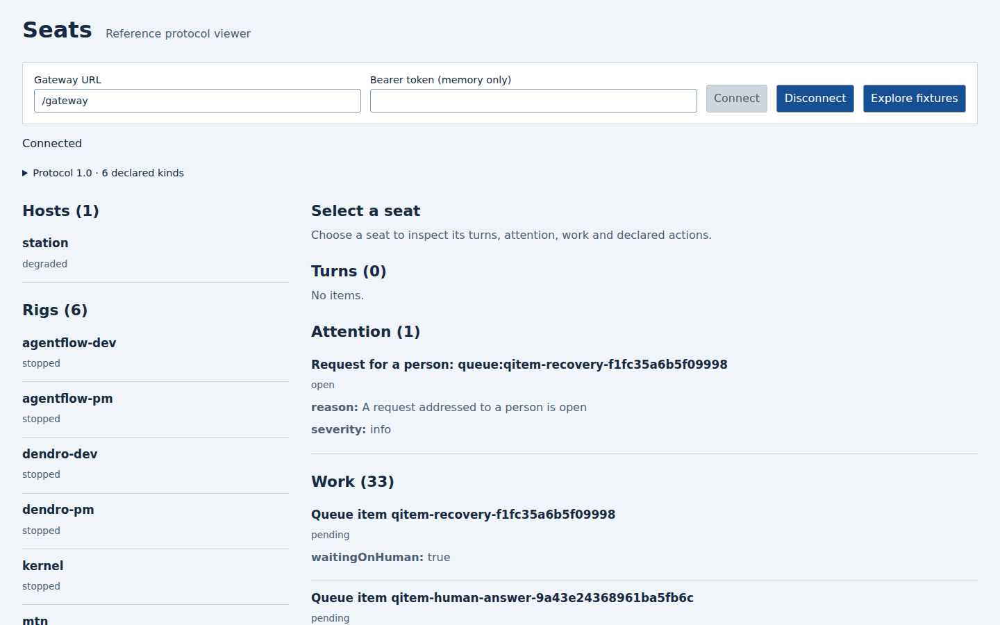

# openrig-seats

A seat gateway and reference web UI for [OpenRig](https://github.com/mvschwarz/openrig).
View seats, activity and work through one small protocol. Build other clients on the same API.
Read-only by default. Pre-1.0; packages are private and not published to npm.

## Quick start

Use Node 22 or 24 and npm 10+. From a clean clone:

```sh
git clone https://github.com/smota/openrig-seats.git
cd openrig-seats
npm ci
npm run build
node examples/minimal/main.mjs
```

Open **http://127.0.0.1:5173**. Leave Gateway URL at `/gateway`, enter
`fictional-demo-bearer`, then choose **Connect**. This public fixture value is not a secret.
The example runs one real gateway and seat-ui against fictional local fixtures.
It needs no accounts, external services or OpenRig daemon. Stop it with Ctrl+C.
Allow about five minutes, including dependency installation on a normal connection.

The gateway uses port 8088 and the UI uses 5173. If either port is in use, the
example exits with a hint. Choose unused ports with
`GATEWAY_PORT=18088 PORT=15173 node examples/minimal/main.mjs`, then open
<http://127.0.0.1:15173>.

See the [minimal example](examples/minimal/README.md) for ports, its automated test and the optional daemon path.



## Implementation guide

Connect the gateway to your existing OpenRig daemon, then point the seat-ui server at the gateway:

```text
OpenRig daemon -> seat gateway -> seat-ui server -> browser
```

Follow the [implementation guide](docs/implementation.md) for configuration and commands.
It uses existing HTTP routes; it does not patch OpenRig.
For a custom client, use the [protocol schemas and client](packages/seat-protocol/README.md).
Read the [package map](docs/architecture.md), [gateway behavior](docs/gateway.md) and
[native reader guide](docs/native-readers.md) when extending those parts.

This independent project follows OpenRig discussion
[#2691](https://github.com/mvschwarz/openrig/discussions/2691).
OpenRig's maintainers have not reviewed or endorsed it.
[More screenshots](docs/architecture.md#screenshots) include a downstream cockpit using the gateway.

## Configuration reference

The gateway reads JSON with `--config <path>`. `tokenFile` is required.
It binds loopback by default. Sending, terminal access and daemon free text are opt-in.
The UI uses `SEAT_GATEWAY_URL` and `PORT`.

See [all settings and defaults](docs/configuration.md), the
[copyable gateway config](packages/seat-gateway/examples/seat-gateway.config.json) and the
[optional user service example](packages/seat-gateway/examples/seat-gateway.service).

## Compatibility

Only the exact OpenRig commit below has a checked-in conformance baseline.
Other revisions need verification; no release range is claimed.

| This repo version | OpenRig release or commit range | Protocol / schema version |
|---|---|---|
| Root `0.0.0`; packages `0.1.0` (private development versions) | `f5b62726ff759a857eeb76e2cbd654493fedba2f` only | Seat protocol `1.0`; schemas `v1` (JSON Schema 2020-12); `x-openrig` `1.0` |

[openrig-compat.json](openrig-compat.json) is the machine-readable declaration.
`npm test` checks declared protocol/schema versions against code and schemas.
See [conformance checks and pin updates](packages/seat-conformance/README.md) and
[CHANGELOG.md](CHANGELOG.md). Git history currently has no release tags.

## Troubleshooting

| Symptom | Check |
|---|---|
| Install or build fails | Use Node 22 or 24 and npm 10+; run `npm ci`, then `npm run build`. |
| UI returns 502 | Start the gateway and check the UI's fixed `SEAT_GATEWAY_URL`. For fixtures, use the minimal example command. |
| UI refuses connection | Use `/gateway` with the standalone UI server. Vite has no gateway adapter. |
| Gateway returns 401 or refuses startup | Use the correct bearer. Live token files must be readable and mode `0600`. |
| Host or Origin refused | Use loopback URLs. Review `allowedHosts` and `allowedOrigins`; keep checks enabled. |
| Terminal or send is absent | Both default off. Read the [gateway guide](docs/gateway.md) before enabling them. |
| Checkout conformance check fails | Set `OPENRIG_CHECKOUT` to a source checkout of the pinned revision; see [conformance](packages/seat-conformance/README.md). |

## Contributing

Reuse the current packages, tests and patterns. Keep one concern per change.
Use fictional fixtures and report exactly what was tested.

```sh
npm ci
npm run build
npm test
npm test -w @openrig-seats/seat-gateway -- minimal-example
npm run check
```

Default tests use fixtures. Upstream source checks and live daemon tests are explicit opt-ins;
see [development and contribution details](docs/contributing.md).
Agents should read [AGENTS.md](AGENTS.md).

Apache-2.0; see [LICENSE](LICENSE).
