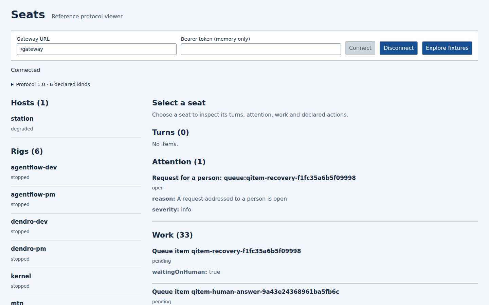
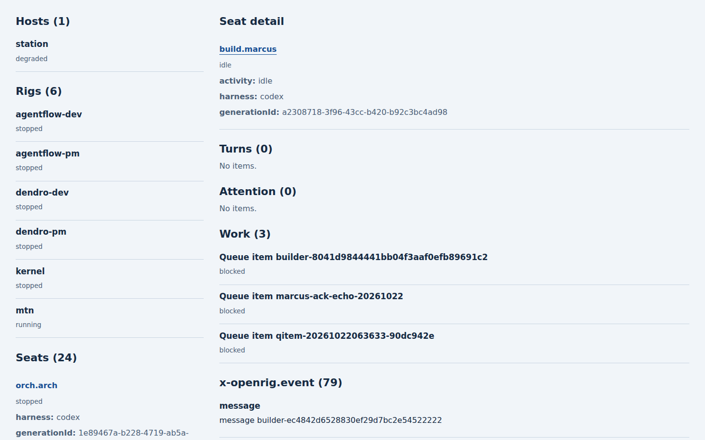
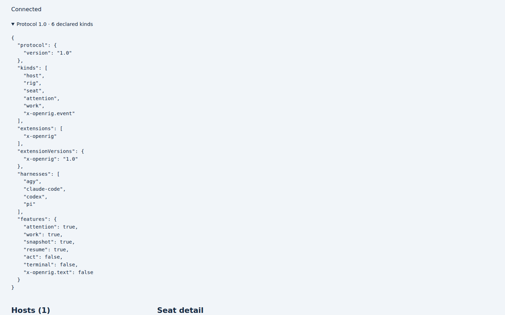
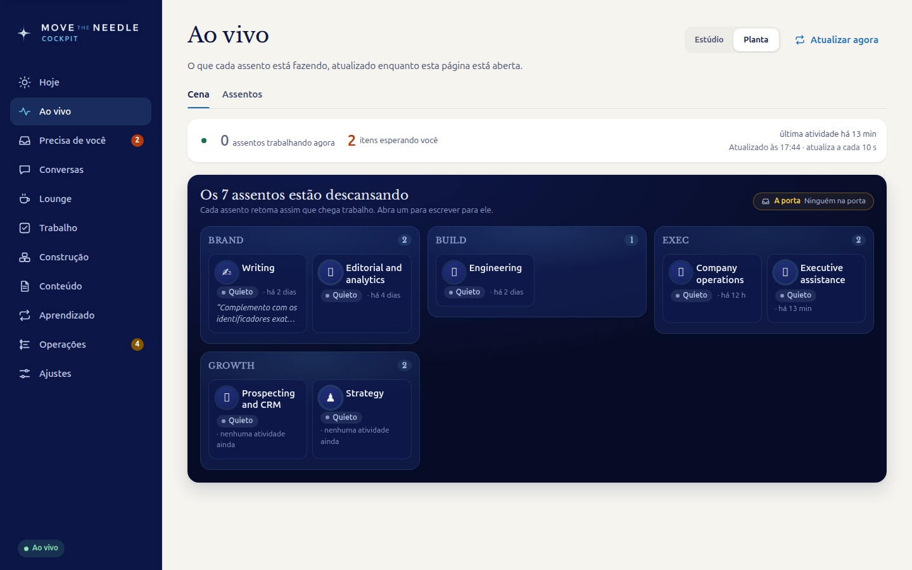
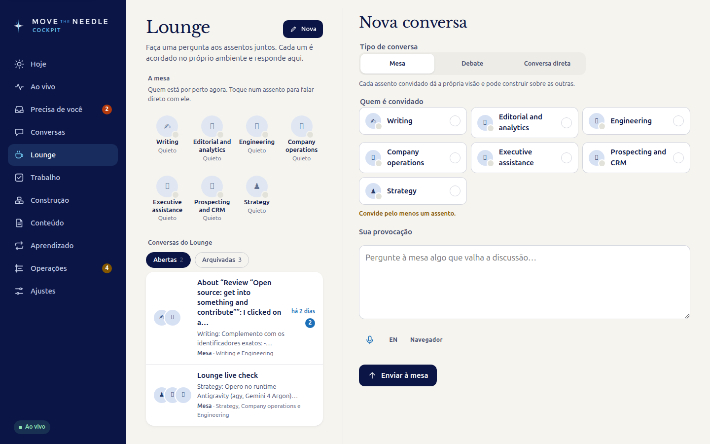

# Packages and data flow

```text
OpenRig HTTP snapshots + events
              |
     seat-source-openrig
              |
        seat-gateway ---- seat-protocol schemas + client
              |
      seat-ui server adapter
              |
          browser UI

Native session records -> seat-readers -> protocol turns
OpenRig source checkout -> seat-conformance -> checked-in snapshot
```

| Package | Content |
|---|---|
| `packages/seat-protocol` | JSON Schemas (2020-12) for `host`, `rig`, `seat`, `turn`, `attention`, `work`, the stream envelope, declared actions, `POST /act` and `GET /capabilities`; valid and invalid fixtures; generated TypeScript types; a dependency-free client (fetch plus SSE parsing, cursor resume). |
| `packages/seat-conformance` | A checked-in snapshot of the OpenRig routes, `transport/send` outcome and failure map, and `RigEvent` names the gateway depends on, re-extracted from an OpenRig checkout; the test fails on any removal or rename. |
| `packages/seat-readers` | Readers that turn a seat's generation record into `turn`s: `claude-jsonl`, `codex-rollout`, `agy-jsonl`, `pi-jsonl` and a plain-text fallback behind one `detect`/`follow` interface; cursor = UTF-8 byte length of complete lines; `generationId[0]` identifies the occupant. |
| `packages/seat-source-openrig` | The only code that knows daemon routes (GET only). Fills the `x-openrig` extension (seat detail and the `x-openrig.event` kind, see `seat-protocol`). Snapshots (`/api/ps`, `/api/rigs/:id/nodes`, `/api/attention`, `/api/queue/list`) plus the `/api/events` stream become `host`, `rig`, `seat`, `attention` and `work` upserts and deletes; resumes from the daemon's event sequence, and does a full resync on a gap or a restarted log. |
| `packages/seat-ui` | Static TypeScript/DOM reference UI driven by capabilities, snapshot, cursor stream and declared action schemas; standalone browser transport adapter. |
| `packages/seat-gateway` | Read-only Hono server: `GET /capabilities`, `GET /stream`, `GET /snapshot`. See below. |

`packages/seat-ui` is a static, protocol-driven reference web UI: hosts, rigs,
seats, turns, attention, work, generic declared-action forms and an optional
read-only terminal. It includes a standalone server for authenticated browser
access to any gateway. See [seat-ui](../packages/seat-ui/README.md) for fixture and
live-gateway instructions.

## Relation to OpenRig

This repository follows the ideas in OpenRig discussion
[#2691](https://github.com/mvschwarz/openrig/discussions/2691). It is an independent project: it uses
only OpenRig's existing HTTP routes and makes no change to OpenRig. The OpenRig maintainers have not
reviewed or endorsed it. Packages follow OpenRig's tooling and use `seat-*` names so that any of them
can move into OpenRig later with a scope rename (OpenRig packages use the `@openrig/*` scope; these use
`@openrig-seats/*`).

## Screenshots

The reference UI uses the same protocol that downstream clients consume. These images are retained from the existing project.







A downstream cockpit built on the gateway:




